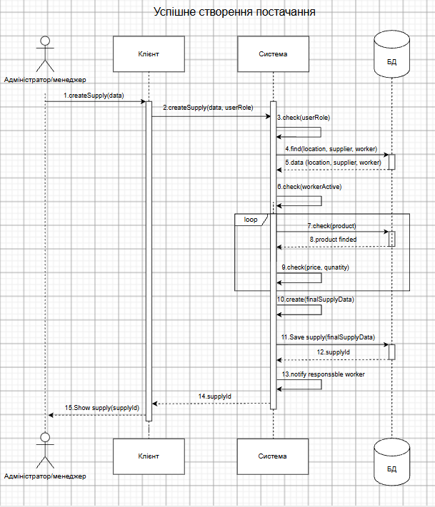
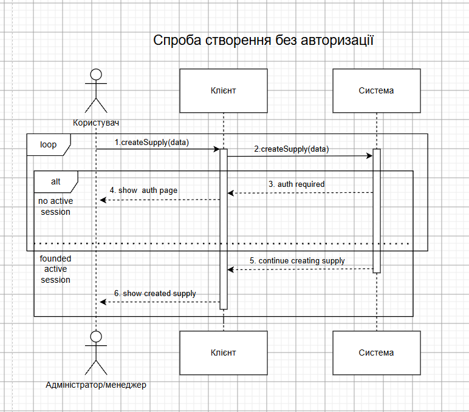
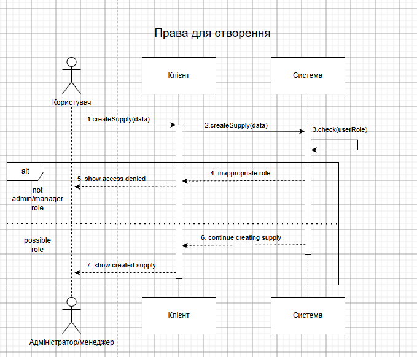
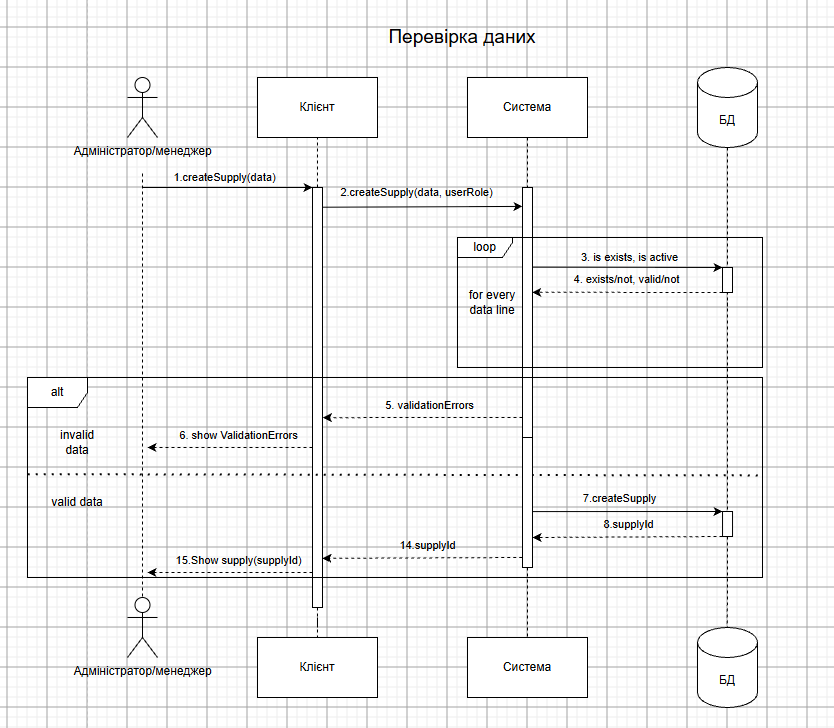
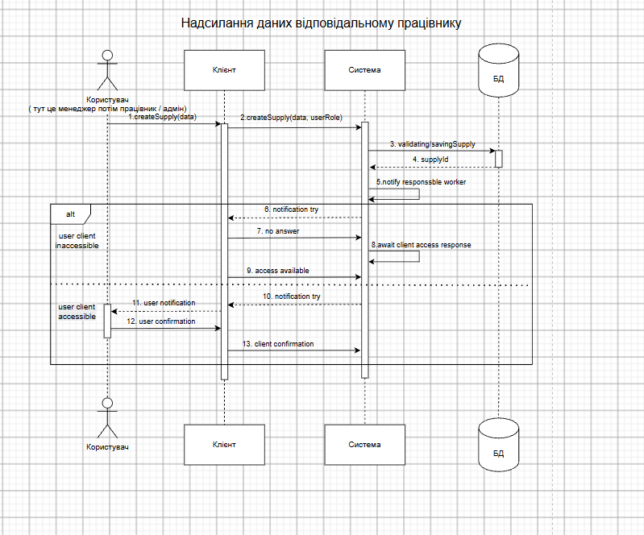
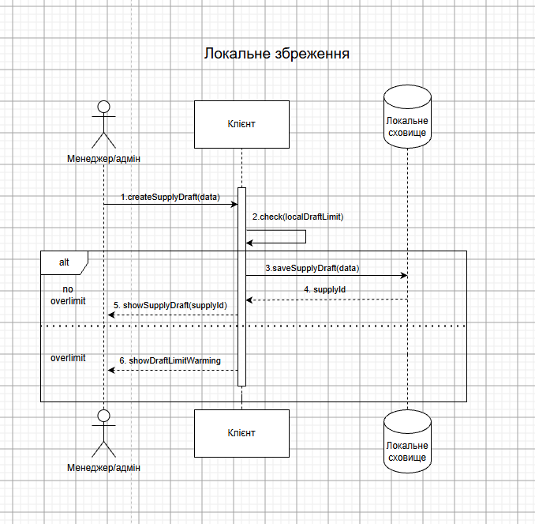

# Вимоги та сценарії при роботі з постачанням

## Намір
Деталізувати взаємодію для UC «Створити постачання» з лабораторної 2.

## 2. Актори та цілі

* Менеджер магазину — створює постачання, зазначає постачальника, локацію, відповідального на складі/магазині та товари для постачання, переглядає і приймає постачання, переглядає запаси.
* Робітник складу — переглядає і приймає постачання, переглядає запаси.
* Адміністратор — створює постачання, переглядає і приймає постачання, переглядає запаси.
* Система
* БД

1) 

2) 

3) 

4) 

5) 

6) 

## Критерії прийняття
* sequence diagrams покривають всі gherkin сценарії
* актори й кроки узгоджені з spec (lab2) і ER моделлю (lab1)

## Додатково
Джерело сценаріїв: посилання на ../lab2/gherkin.feature; 
Перелік сценаріїв G-01–G-14.